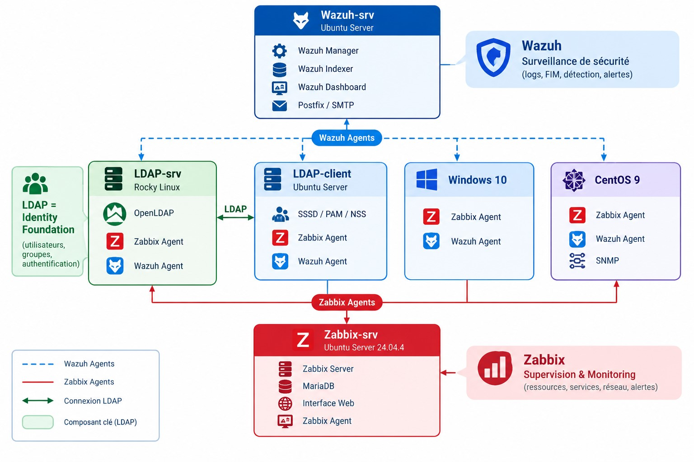

# Centralized Infrastructure Monitoring, Identity Management and Security

## Overview

This project implements a centralized IT infrastructure platform integrating three complementary technologies:

- **OpenLDAP** — centralized identity management and authentication for configured Linux systems.
- **Zabbix** — infrastructure monitoring, performance tracking, service availability and alerting.
- **Wazuh** — security event collection and analysis, File Integrity Monitoring (FIM), and custom detection rules.

The platform was deployed in a virtualized lab environment with Linux and Windows systems.

## Architecture

The infrastructure consists of dedicated servers and monitored endpoints.

- **LDAP Server:** Rocky Linux, OpenLDAP and monitoring/security agents.
- **LDAP Client:** Ubuntu Server, SSSD, PAM and NSS.
- **Zabbix Server:** Ubuntu Server 24.04.4, Zabbix Server, MariaDB and Web Interface.
- **Wazuh Server:** Wazuh Manager, Wazuh Indexer, Wazuh Dashboard and email notification components.
- **Endpoints:** Windows 10 and CentOS Stream 9 with monitoring and security agents.

### Architecture Diagram

## Key Features

### 1. Centralized Identity Management
- Centralized user directory using OpenLDAP.
- Linux identity integration using SSSD, PAM and NSS.
- Authentication testing and automatic home directory creation.

### 2. Infrastructure Monitoring
- CPU, memory, disk and network monitoring.
- Host and service availability monitoring.
- SNMP-based monitoring tests.
- Email notifications for configured alerts.

### 3. Security Monitoring
- Security event collection using Wazuh agents.
- File Integrity Monitoring (FIM).
- Custom decoders and detection rules for selected LDAP authentication events.
- Email notification for configured security alerts.

## Technologies

OpenLDAP · SSSD · PAM · NSS · Zabbix · Wazuh · SNMP ·
Ubuntu Server · Rocky Linux · CentOS Stream · Windows 10 · Virtualization 

## Validation

The lab was tested through scenarios covering:

- LDAP user lookup and authentication.
- Monitoring agent connectivity.
- Resource and service monitoring.
- SNMP queries.
- Security event collection.
- File integrity monitoring.
- Detection of selected LDAP authentication failures.
- Email alert delivery.

## Project Scope and Limitations

This project is a laboratory implementation intended to demonstrate integration and validation of infrastructure administration and security monitoring technologies. It is not presented as a production-ready high-availability deployment or a fully automated SIEM/SOAR solution.

## Author

ANGAR YOUNESS 
Master's student in Computer Networks and Systems  
FST Settat — Université Hassan Premier

## Disclaimer

This repository is intended for educational and defensive system administration purposes. Do not publish credentials, private keys, authentication tokens, sensitive logs or confidential infrastructure information.
